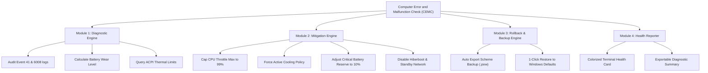

# Product Requirement Document (PRD)
## Project: Computer Error and Malfunction Check (CEMC)
**Author / Maintainer:** @Z3py  
**Repository:** [https://github.com/Z3py/computer-error-and-malfunction-check](https://github.com/Z3py/computer-error-and-malfunction-check)  
**License:** MIT License  
**Target Platform:** Windows 10 & Windows 11 (Universal: MSI, ASUS, Lenovo, Acer, HP, Dell, Surface, etc.)

---

## 1. Executive Summary & Problem Statement

### 1.1 Real-World Context
Millions of Windows laptops (especially modern Intel 11th/12th/13th/14th Gen and AMD Ryzen thin-and-lights) suffer from **sudden, random power shutdowns**:
- The screen goes black instantly without a Blue Screen of Death (BSOD).
- Windows logs **Kernel-Power Event ID 41 with `BugcheckCode: 0`**.
- It occurs during active work, heavy tabs, zoom meetings, or gaming, even while plugged into the charger.
- After repeated sudden shutoffs, Windows triggers the scary **Startup Repair / Automatic Repair** screen.

Most users falsely assume a broken motherboard or faulty Windows installation. In reality, the causes are rooted in three interrelated factors:
1. **Aggressive CPU Turbo Boost Thermal Spikes:** Thin chassis cooling solutions cannot disperse instantaneous 45W–65W+ heat surges, breaching the ACPI Critical Temperature limit (`_CRT = 100°C`) and triggering a hardware-level thermal cutoff.
2. **Degraded Battery Voltage Sags:** Batteries with wear levels >30% have high internal resistance. Under sudden peak current draw, the voltage collapses below the motherboard cutoff, causing brownouts.
3. **Modern Standby (S0) & Fast Startup Glitches:** Sleep sessions attempt background cloud sync, overheat in bags, and fail during hibernation wake transitions.

### 1.2 The Solution: CEMC
A lightweight, transparent, zero-dependency utility that automatically inspects hardware/power health, calculates battery wear, checks shutdown event logs, and applies deterministic, reversible power stabilization mitigations in 1-click.

---

## 2. Goals & Non-Goals

### 2.1 Goals
- **Universal:** Works across all OEM manufacturers (MSI, ASUS, Lenovo, Dell, HP, etc.) and CPU architectures (Intel & AMD).
- **Zero-Dependency:** Native PowerShell & CMD script requiring no third-party runtimes or installers.
- **100% Reversible:** Automatic power scheme backup before changes, with a dedicated 1-click Restore Defaults option.
- **Safety & Transparency:** Clean, open-source code with zero hidden telemetry and no unverified binaries.

### 2.2 Non-Goals
- Does not modify hardware firmware / BIOS chips directly.
- Does not replace physical hardware repairs when battery cells or cooling fans are physically dead/broken.

---

## 3. Architecture & Functional Modules

### 3.1 Module 1: Diagnostic Engine (`Check-System.ps1`)
- **Event Viewer Analysis:** Scans `System` log for Event ID 41 and 6008 in the last 30 days; determines whether crashes are BSOD (BugcheckCode != 0) or Instant Power Cuts (BugcheckCode == 0).
- **Battery Health Engine:** Queries `BatteryStaticData` and `BatteryFullChargedCapacity` via WMI; calculates wear percentage:
  $$\text{Wear Level} = 100\% - \left(\frac{\text{Full Charge Capacity}}{\text{Design Capacity}} \times 100\%\right)$$
- **Thermal & ACPI Query:** Queries ACPI thermal zones for `_CRT` (Critical Trip Point, usually 373K / 100°C).
- **Registry & Power Settings:** Audits `HiberbootEnabled` and current processor throttle maximum.

### 3.2 Module 2: Mitigation Engine (`Apply-Fix.ps1`)
- **CPU Thermal & Burst Power Guard:**
  - `powercfg /setacvalueindex SCHEME_CURRENT SUB_PROCESSOR PROCTHROTTLEMAX 99`
  - `powercfg /setdcvalueindex SCHEME_CURRENT SUB_PROCESSOR PROCTHROTTLEMAX 99`
  - `powercfg /setacvalueindex SCHEME_CURRENT SUB_PROCESSOR SYSCOOLPOL 1`
  - `powercfg /setdcvalueindex SCHEME_CURRENT SUB_PROCESSOR SYSCOOLPOL 1`
- **Battery Brownout Shield:**
  - `powercfg /setdcvalueindex SCHEME_CURRENT SUB_BATTERY BATLEVELLOW 15`
  - `powercfg /setdcvalueindex SCHEME_CURRENT SUB_BATTERY BATLEVELCRIT 10`
  - `powercfg /setdcvalueindex SCHEME_CURRENT SUB_BATTERY BATACTIONCRIT 2` (Hibernate)
- **Fast Startup & Standby Optimization:**
  - `reg add "HKLM\SYSTEM\CurrentControlSet\Control\Session Manager\Power" /v HiberbootEnabled /t REG_DWORD /d 0 /f`
  - `powercfg /setdcvalueindex SCHEME_CURRENT SUB_NONE CONNECTIVITYINSTANDBY 0`
  - `powercfg /setacvalueindex SCHEME_CURRENT SUB_NONE CONNECTIVITYINSTANDBY 0`

### 3.3 Module 3: Rollback & Backup Engine (`Restore-Defaults.ps1`)
- Automatically saves a `.pow` power plan backup prior to modifying settings.
- One-click restore command:
  - `powercfg /restoredefaultschemes`
  - `reg add "HKLM\SYSTEM\CurrentControlSet\Control\Session Manager\Power" /v HiberbootEnabled /t REG_DWORD /d 1 /f`

---

## 4. Release Roadmap

- **v0.1 (MVP - Current):** Pure PowerShell CLI & 1-click batch wrappers for Check, Fix, and Restore.
- **v0.2:** Multi-language output (English & Indonesian), interactive console menu.
- **v0.3:** Automated HTML health report export with shareable diagnostic graphs.
- **v1.0:** Modern GUI application (WPF / WinUI 3) with real-time hardware temperature monitors and one-click toggle switches.
